# Revisão de anatomia dos quadros (#51, item 3)

Revisão de 2026-11-15, pedida pelo Breno na missão [`missao-alisson-estilo-melty.md`](../missao-alisson-estilo-melty.md):
todos os desenhos-chave dos cinco lutadores, nas duas formas, contra a regra "anatomia vem antes da fluidez" de
[`regras-dos-lutadores.md`](../regras-dos-lutadores.md). Foram olhados **2.680 desenhos** (335 folhas de 8).

**Estado: só a revisão está feita. Nenhum quadro foi redesenhado ainda**, então isto aqui é o "antes". O redesenho é
no ChatGPT, com a referência de cada lutador anexada, e depende do Alisson abrir o navegador com a conta dele.

## Resultado

| Lutador | Folhas para redesenhar | Quadros para redesenhar | Quadros leves | Quadros só com mancha de cor |
|---|---|---|---|---|
| Hazak (base) | 12 | 34 | 14 | 0 |
| Diabo Loiro | 10 | 28 | 14 | 0 |
| CK (base e Ratão) | 6 | 9 | 10 | 5 |
| Pengaró (base e Endiabrado) | 10 | 24 | 6 | 3 |
| Gutto (base e Garanhão) | 10 | 21 | 2 | 20 |
| Raiclaven | 3 | 7 | 10 | 2 |
| **Total** | **51** | **123** | **56** | **30** |

O que mais se repete:

1. **Membro que estica** no quadro de contato muito além dos 15% que o prompt pede (rasteiras, pisões, braço erguido).
   É o defeito mais comum no Hazak e no Diabo Loiro.
2. **Quadro de costas** (giros e agarrões) sai com outra altura e outra largura: Hazak, Diabo, CK, Pengaró e Raiclaven.
3. **Corpo que muda de modelo** quando fica em pé ou de frente: o Garanhão do Gutto vira um humanoide magro em 7 folhas,
   a vitória do Pengaró emagrece, o Hazak correndo ganha a pulseira no bíceps.
4. **Sobras de outro desenho**: antebraço sem manga em dois golpes do Diabo Loiro, Pengaró de pele clara no começo da
   segunda metade da cena do Despertar, cabelo castanho no Gutto bebendo.

O Raiclaven é o mais firme dos cinco. Os despertados do Gutto e do Raiclaven saem dos mesmos desenhos da forma base
(o Raiclaven por paleta), então consertar a base conserta os dois.

## Folha de contato do antes

Uma linha por folha, os 8 desenhos na mesma escala. **Vermelho** = redesenhar, **amarelo** = leve (o Breno decide se
entra), **ciano** = só mancha de cor, que se conserta sem redesenhar. O número no canto é o do arquivo (`00.png` = 0).

### hazaki

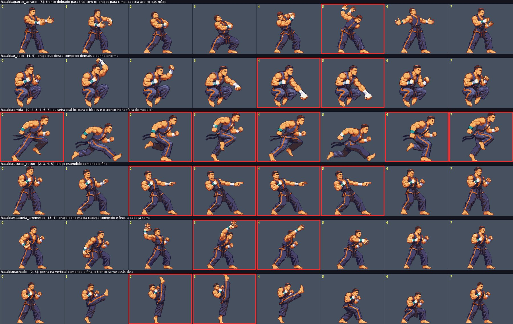
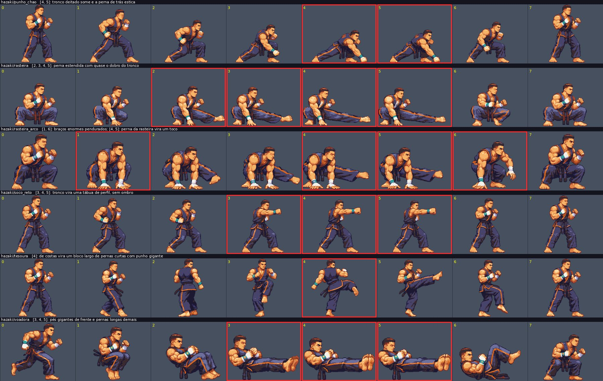
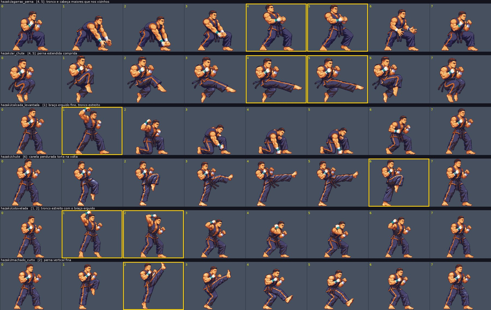
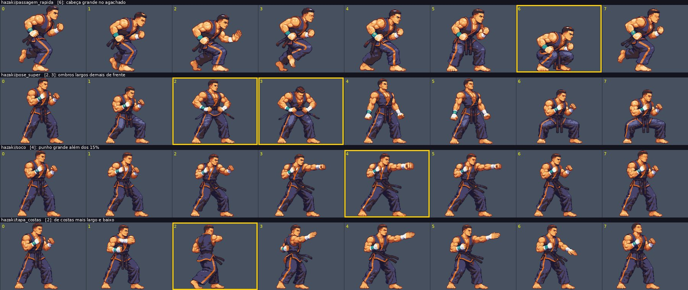

### diabo_loiro

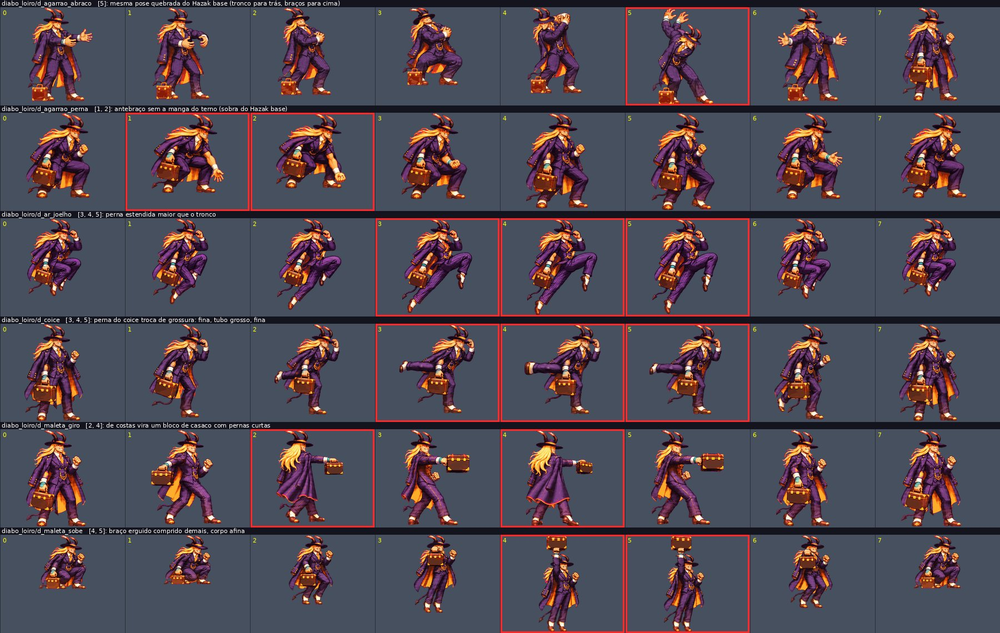
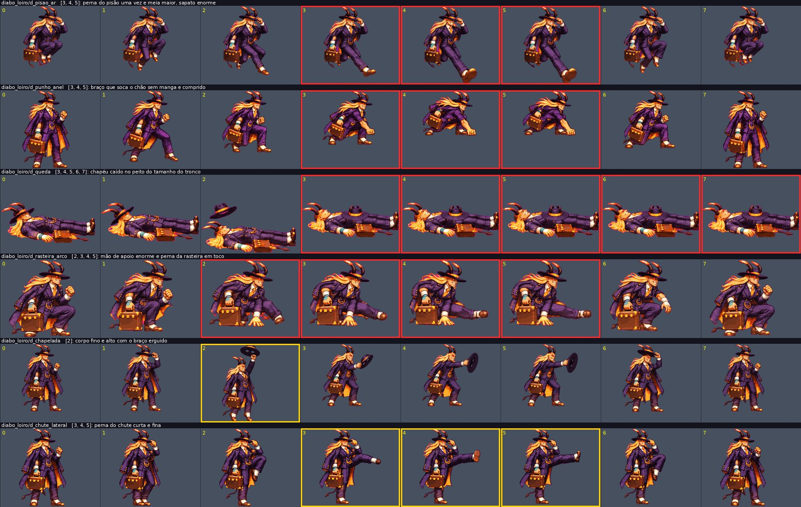
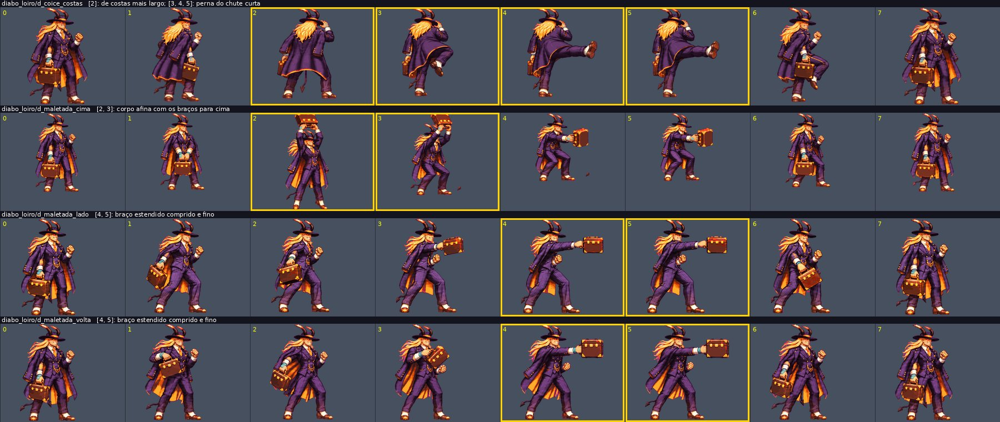

### ck

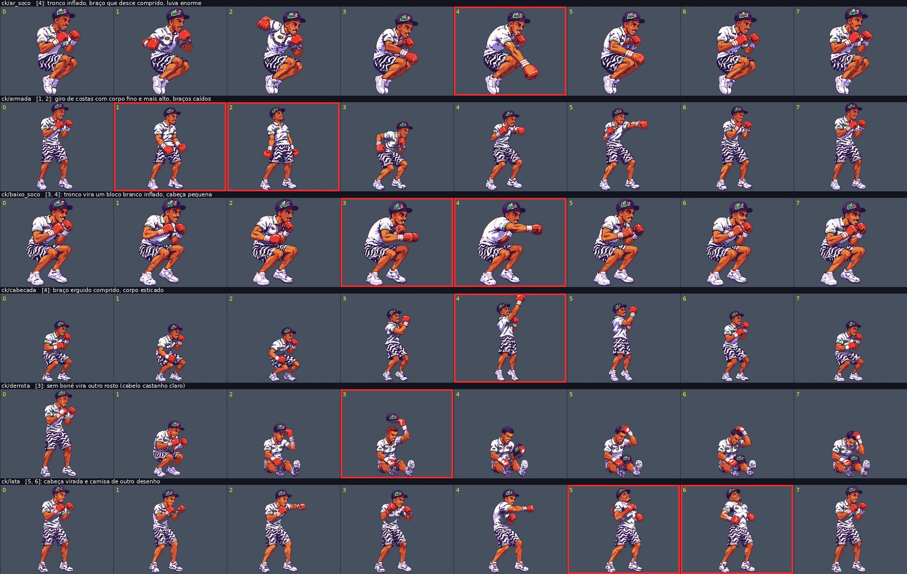
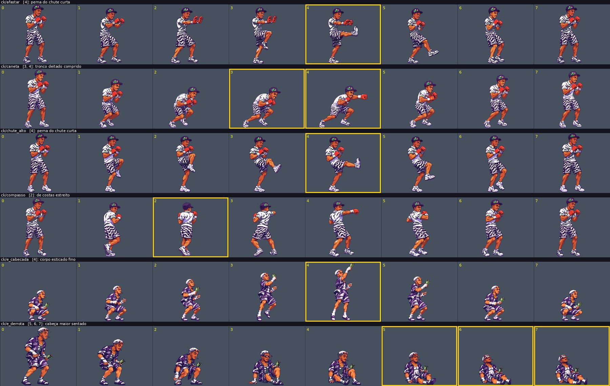
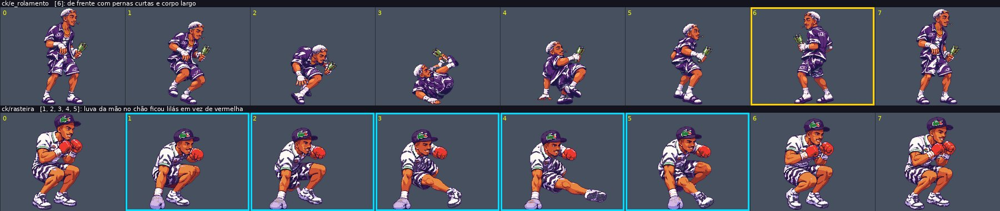

### pengaro

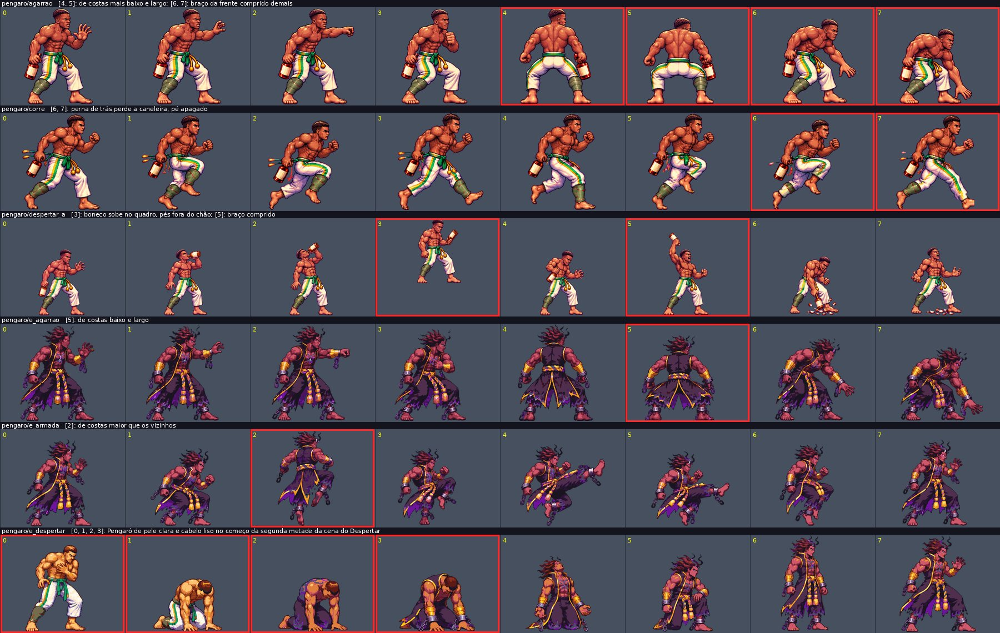
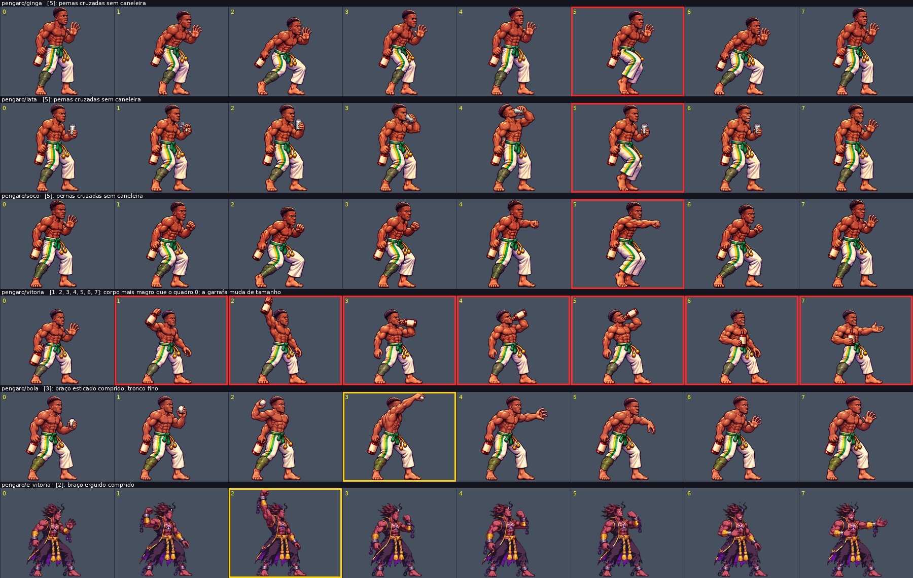
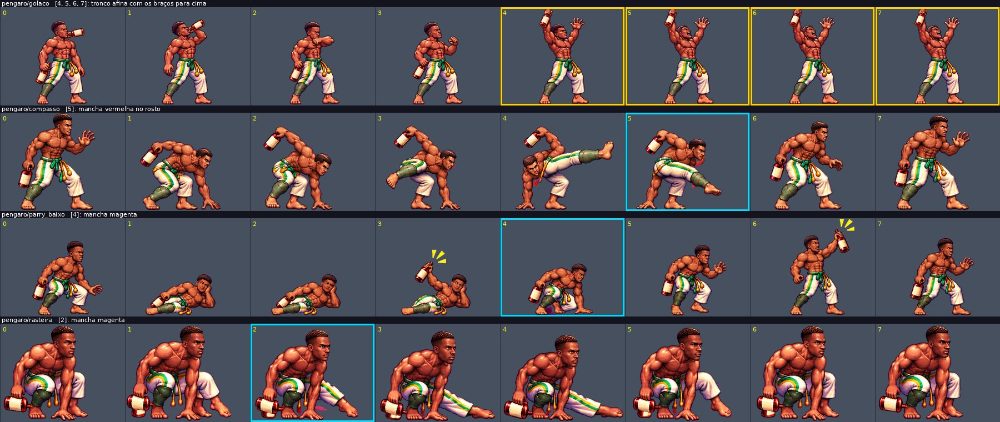

### gutto

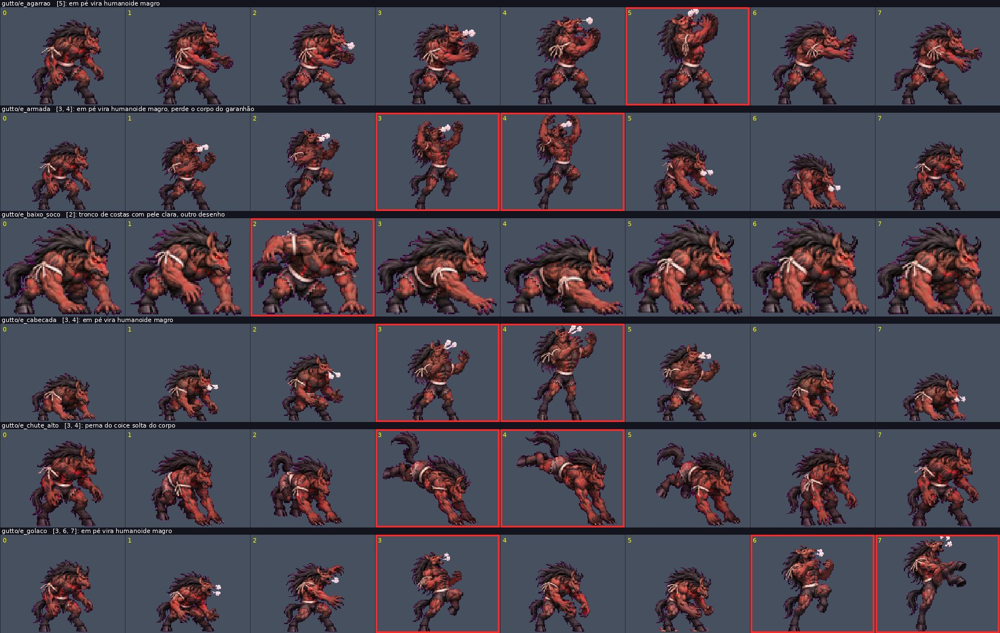
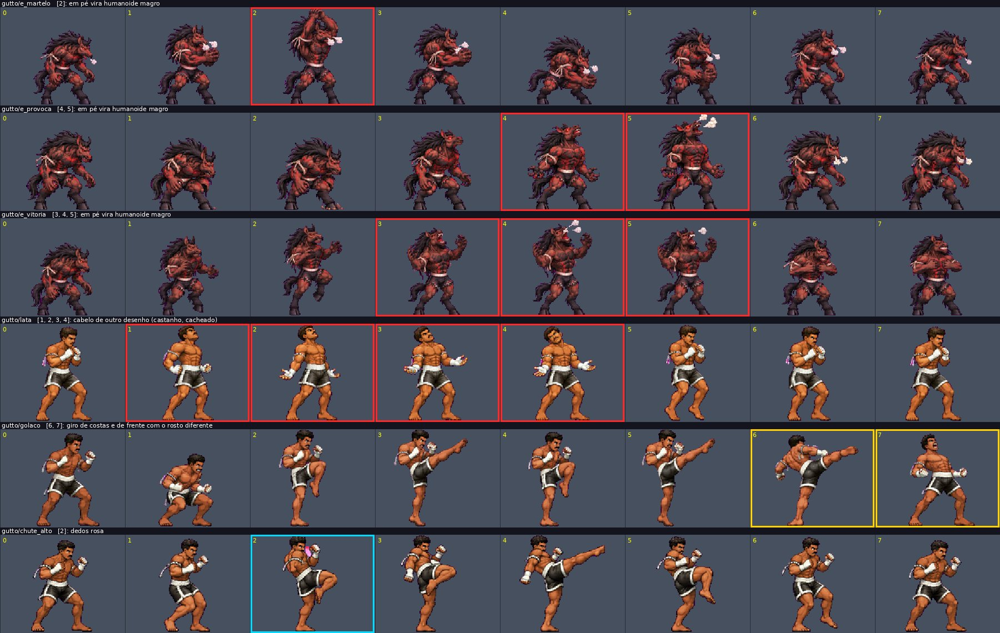
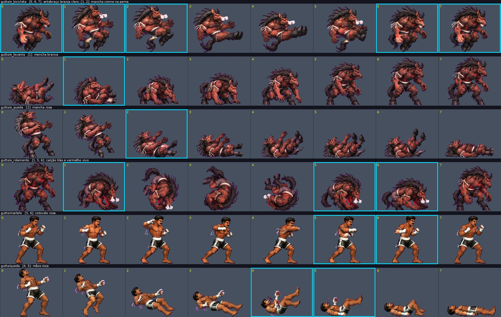
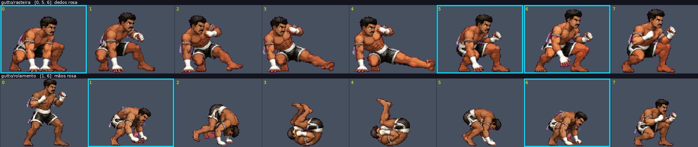

### raiclaven

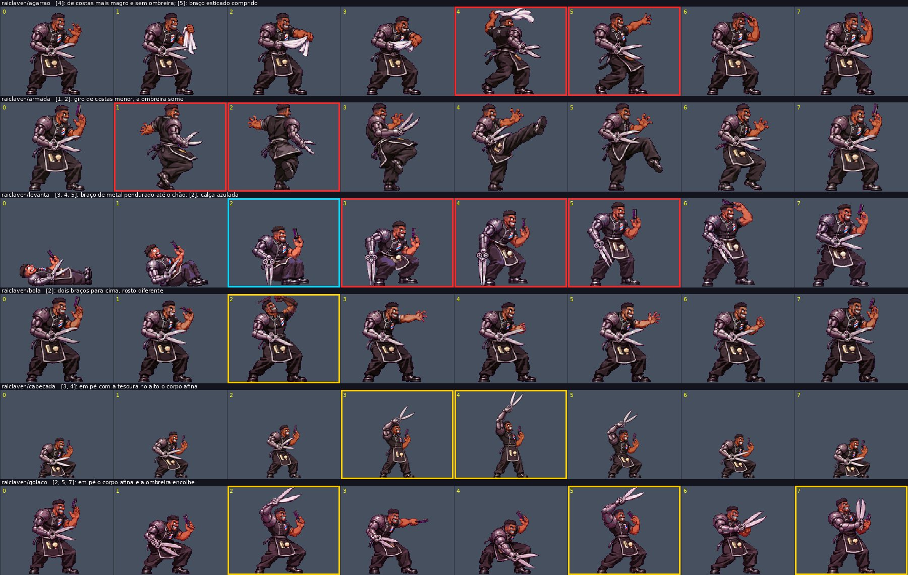
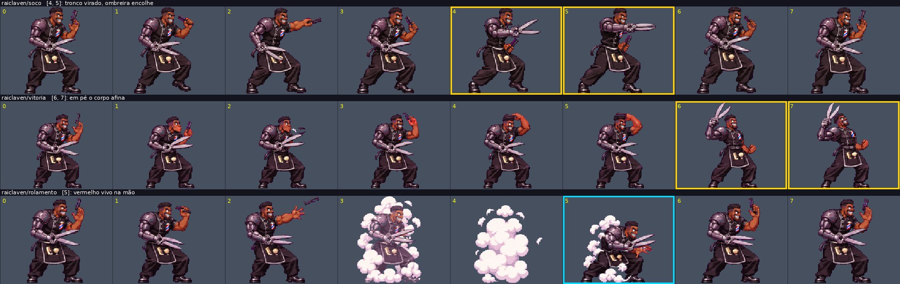

## Lista completa

### hazaki (12 folhas para redesenhar)

| Folha | Quadros | Nível | Defeito |
|---|---|---|---|
| `agarrao_abraco` | 5 | redesenhar | tronco dobrado para trás com os braços para cima, cabeça abaixo das mãos |
| `ar_soco` | 4, 5 | redesenhar | braço que desce comprido demais e punho enorme |
| `corrida` | 0, 2, 3, 4, 6, 7 | redesenhar | pulseira teal foi para o bíceps e o tronco incha (fora do modelo) |
| `cutucao_recuo` | 2, 3, 4, 5 | redesenhar | braço estendido comprido e fino |
| `estatueta_arremesso` | 3, 4 | redesenhar | braço por cima da cabeça comprido e fino, a cabeça some |
| `machado` | 2, 3 | redesenhar | perna na vertical comprida e fina, o tronco some atrás dela |
| `punho_chao` | 4, 5 | redesenhar | tronco deitado some e a perna de trás estica |
| `rasteira` | 2, 3, 4, 5 | redesenhar | perna estendida com quase o dobro do tronco |
| `rasteira_arco` | 1, 6 | redesenhar | braços enormes pendurados |
| `rasteira_arco` | 4, 5 | redesenhar | perna da rasteira vira um toco |
| `soco_reto` | 3, 4, 5 | redesenhar | tronco vira uma tábua de perfil, sem ombro |
| `tesoura` | 4 | redesenhar | de costas vira um bloco largo de pernas curtas com punho gigante |
| `voadora` | 3, 4, 5 | redesenhar | pés gigantes de frente e pernas longas demais |
| `agarrao_perna` | 4, 5 | leve | tronco e cabeça maiores que nos vizinhos |
| `ar_chute` | 4, 5 | leve | perna estendida comprida |
| `calcada_levantada` | 1 | leve | braço erguido fino, tronco estreito |
| `chute` | 6 | leve | canela pendurada torta na volta |
| `cotovelada` | 1, 2 | leve | tronco estreito com o braço erguido |
| `machado_curto` | 2 | leve | perna vertical fina |
| `passagem_rapida` | 6 | leve | cabeça grande no agachado |
| `pose_super` | 2, 3 | leve | ombros largos demais de frente |
| `soco` | 4 | leve | punho grande além dos 15% |
| `tapa_costas` | 2 | leve | de costas mais largo e baixo |

### diabo_loiro (10 folhas para redesenhar)

| Folha | Quadros | Nível | Defeito |
|---|---|---|---|
| `d_agarrao_abraco` | 5 | redesenhar | mesma pose quebrada do Hazak base (tronco para trás, braços para cima) |
| `d_agarrao_perna` | 1, 2 | redesenhar | antebraço sem a manga do terno (sobra do Hazak base) |
| `d_ar_joelho` | 3, 4, 5 | redesenhar | perna estendida maior que o tronco |
| `d_coice` | 3, 4, 5 | redesenhar | perna do coice troca de grossura: fina, tubo grosso, fina |
| `d_maleta_giro` | 2, 4 | redesenhar | de costas vira um bloco de casaco com pernas curtas |
| `d_maleta_sobe` | 4, 5 | redesenhar | braço erguido comprido demais, corpo afina |
| `d_pisao_ar` | 3, 4, 5 | redesenhar | perna do pisão uma vez e meia maior, sapato enorme |
| `d_punho_anel` | 3, 4, 5 | redesenhar | braço que soca o chão sem manga e comprido |
| `d_queda` | 3, 4, 5, 6, 7 | redesenhar | chapéu caído no peito do tamanho do tronco |
| `d_rasteira_arco` | 2, 3, 4, 5 | redesenhar | mão de apoio enorme e perna da rasteira em toco |
| `d_chapelada` | 2 | leve | corpo fino e alto com o braço erguido |
| `d_chute_lateral` | 3, 4, 5 | leve | perna do chute curta e fina |
| `d_coice_costas` | 2 | leve | de costas mais largo |
| `d_coice_costas` | 3, 4, 5 | leve | perna do chute curta |
| `d_maletada_cima` | 2, 3 | leve | corpo afina com os braços para cima |
| `d_maletada_lado` | 4, 5 | leve | braço estendido comprido e fino |
| `d_maletada_volta` | 4, 5 | leve | braço estendido comprido e fino |

### ck (6 folhas para redesenhar)

| Folha | Quadros | Nível | Defeito |
|---|---|---|---|
| `ar_soco` | 4 | redesenhar | tronco inflado, braço que desce comprido, luva enorme |
| `armada` | 1, 2 | redesenhar | giro de costas com corpo fino e mais alto, braços caídos |
| `baixo_soco` | 3, 4 | redesenhar | tronco vira um bloco branco inflado, cabeça pequena |
| `cabecada` | 4 | redesenhar | braço erguido comprido, corpo esticado |
| `derrota` | 3 | redesenhar | sem boné vira outro rosto (cabelo castanho claro) |
| `lata` | 5, 6 | redesenhar | cabeça virada e camisa de outro desenho |
| `afastar` | 4 | leve | perna do chute curta |
| `caneta` | 3, 4 | leve | tronco deitado comprido |
| `chute_alto` | 4 | leve | perna do chute curta |
| `compasso` | 2 | leve | de costas estreito |
| `e_cabecada` | 4 | leve | corpo esticado fino |
| `e_derrota` | 5, 6, 7 | leve | cabeça maior sentado |
| `e_rolamento` | 6 | leve | de frente com pernas curtas e corpo largo |
| `rasteira` | 1, 2, 3, 4, 5 | cor | luva da mão no chão ficou lilás em vez de vermelha |

### pengaro (10 folhas para redesenhar)

| Folha | Quadros | Nível | Defeito |
|---|---|---|---|
| `agarrao` | 4, 5 | redesenhar | de costas mais baixo e largo |
| `agarrao` | 6, 7 | redesenhar | braço da frente comprido demais |
| `corre` | 6, 7 | redesenhar | perna de trás perde a caneleira, pé apagado |
| `despertar_a` | 3 | redesenhar | boneco sobe no quadro, pés fora do chão |
| `despertar_a` | 5 | redesenhar | braço comprido |
| `e_agarrao` | 5 | redesenhar | de costas baixo e largo |
| `e_armada` | 2 | redesenhar | de costas maior que os vizinhos |
| `e_despertar` | 0, 1, 2, 3 | redesenhar | Pengaró de pele clara e cabelo liso no começo da segunda metade da cena do Despertar |
| `ginga` | 5 | redesenhar | pernas cruzadas sem caneleira |
| `lata` | 5 | redesenhar | pernas cruzadas sem caneleira |
| `soco` | 5 | redesenhar | pernas cruzadas sem caneleira |
| `vitoria` | 1, 2, 3, 4, 5, 6, 7 | redesenhar | corpo mais magro que o quadro 0; a garrafa muda de tamanho |
| `bola` | 3 | leve | braço esticado comprido, tronco fino |
| `e_vitoria` | 2 | leve | braço erguido comprido |
| `golaco` | 4, 5, 6, 7 | leve | tronco afina com os braços para cima |
| `compasso` | 5 | cor | mancha vermelha no rosto |
| `parry_baixo` | 4 | cor | mancha magenta |
| `rasteira` | 2 | cor | mancha magenta |

### gutto (10 folhas para redesenhar)

| Folha | Quadros | Nível | Defeito |
|---|---|---|---|
| `e_agarrao` | 5 | redesenhar | em pé vira humanoide magro |
| `e_armada` | 3, 4 | redesenhar | em pé vira humanoide magro, perde o corpo do garanhão |
| `e_baixo_soco` | 2 | redesenhar | tronco de costas com pele clara, outro desenho |
| `e_cabecada` | 3, 4 | redesenhar | em pé vira humanoide magro |
| `e_chute_alto` | 3, 4 | redesenhar | perna do coice solta do corpo |
| `e_golaco` | 3, 6, 7 | redesenhar | em pé vira humanoide magro |
| `e_martelo` | 2 | redesenhar | em pé vira humanoide magro |
| `e_provoca` | 4, 5 | redesenhar | em pé vira humanoide magro |
| `e_vitoria` | 3, 4, 5 | redesenhar | em pé vira humanoide magro |
| `lata` | 1, 2, 3, 4 | redesenhar | cabelo de outro desenho (castanho, cacheado) |
| `golaco` | 6, 7 | leve | giro de costas e de frente com o rosto diferente |
| `chute_alto` | 2 | cor | dedos rosa |
| `e_bicicleta` | 0, 6, 7 | cor | antebraço laranja claro |
| `e_bicicleta` | 1, 2 | cor | mancha creme na perna |
| `e_levanta` | 1 | cor | mancha branca |
| `e_queda` | 2 | cor | mancha rosa |
| `e_rolamento` | 1, 5, 6 | cor | calção lilás e vermelho vivo |
| `martelo` | 5, 6 | cor | cotovelo rosa |
| `queda` | 4, 5 | cor | mãos rosa |
| `rasteira` | 0, 5, 6 | cor | dedos rosa |
| `rolamento` | 1, 6 | cor | mãos rosa |

### raiclaven (3 folhas para redesenhar)

| Folha | Quadros | Nível | Defeito |
|---|---|---|---|
| `agarrao` | 4 | redesenhar | de costas mais magro e sem ombreira |
| `agarrao` | 5 | redesenhar | braço esticado comprido |
| `armada` | 1, 2 | redesenhar | giro de costas menor, a ombreira some |
| `levanta` | 3, 4, 5 | redesenhar | braço de metal pendurado até o chão |
| `levanta` | 2 | cor | calça azulada |
| `bola` | 2 | leve | dois braços para cima, rosto diferente |
| `cabecada` | 3, 4 | leve | em pé com a tesoura no alto o corpo afina |
| `golaco` | 2, 5, 7 | leve | em pé o corpo afina e a ombreira encolhe |
| `soco` | 4, 5 | leve | tronco virado, ombreira encolhe |
| `vitoria` | 6, 7 | leve | em pé o corpo afina |
| `rolamento` | 5 | cor | vermelho vivo na mão |

## Como redesenhar

Uma folha inteira por vez (os 8 quadros), no chat do lutador, com o **prompt base e o MOTION que já existem** e mais
o bloco de correção abaixo no fim. Redesenhar a folha toda evita emenda entre quadro novo e quadro velho.

| Lutador | Prompt base e MOTION | Anexar |
|---|---|---|
| Hazak | [`arcade/fila_hazak.md`](../arcade/fila_hazak.md), prompt base | `sprites/hazaki/quadros/folhas_arcade/parado.png` e a folha atual |
| Diabo Loiro | [`arcade/fila_hazak.md`](../arcade/fila_hazak.md), prompt `d_` | o conceito `sprites/hazaki/diabo-loiro.png`, a `parado.png` do Hazak (tamanho do corpo) e a folha atual |
| CK | [`fichas/ck.md`](../fichas/ck.md) | `sprites/ck/quadros/folhas/modelo.png` e a folha atual |
| Pengaró | [`arcade/pengaro.md`](../arcade/pengaro.md) | `sprites/pengaro/quadros/folhas_novas/ginga.png` e a folha atual; Endiabrado: `folhas_arcade/e_conceito.png` |
| Gutto | [`arcade/gutto.md`](../arcade/gutto.md) | `referencia_idle.png`; Garanhão: `demonio_modelo.png`; e a folha atual |
| Raiclaven | [`arcade/raiclaven.md`](../arcade/raiclaven.md) | `referencia_ginga.png` e a folha atual |

Bloco de correção, colado depois da linha `MOTION:` (troque a linha `FIX` pela da folha, na tabela abaixo):

```
This is a correction of the second attached sheet: keep its 8 poses, timing and framing, and redraw it fixing anatomy.
Anatomy lock: in all 8 frames the character has exactly the same head size, shoulder width, torso length, arm length
and leg length as in the first attached reference sheet. Arms and legs never stretch: an extended arm is as long as the
arm at rest, an extended leg is as long as the standing leg. Only on the single contact frame the striking fist or foot
may be up to 15% larger, never longer. When he turns his back or faces the camera, height, shoulder width and leg
length stay the same as in side view. Clothes, wraps, wristband and props stay on the same limb and the same size in
every frame. No extra limbs, no missing limbs, both feet fully drawn.
FIX: <linha da folha>
```

### hazaki

| Folha | Linha FIX |
|---|---|
| `agarrao_abraco` | `FIX: frame 6: the torso must stay upright while he lifts, head above the hands, spine not bent backwards.` |
| `ar_soco` | `FIX: frames 5-6: the punching arm keeps the same length as in frame 1, the fist at most 15% larger.` |
| `corrida` | `FIX: all frames: teal wristband on the rear WRIST only, never on the biceps; torso the same size as in the idle sheet.` |
| `cutucao_recuo` | `FIX: frames 3-6: the extended arm keeps normal length and thickness (shoulder to fist = shoulder to hip).` |
| `estatueta_arremesso` | `FIX: frames 4-5: the overhead arm keeps normal length and thickness, the head stays fully visible.` |
| `machado` | `FIX: frames 3-4: the raised leg keeps the same length and thickness as the standing leg, the torso stays visible.` |
| `punho_chao` | `FIX: frames 5-6: the torso keeps its full size while leaning, the rear leg keeps normal length.` |
| `rasteira` | `FIX: frames 3-6: the sweeping leg is exactly as long as the standing leg in the idle sheet.` |
| `rasteira_arco` | `FIX: frames 2 and 7: arms of normal length, hands do not hang below the knees; frames 5-6: the sweeping leg at full length.` |
| `soco_reto` | `FIX: frames 4-6: keep the full shoulder and chest width in three-quarter view, never a flat profile plank.` |
| `tesoura` | `FIX: frame 5: back view with the same height, shoulder width and leg length as the front view, fists of normal size.` |
| `voadora` | `FIX: frames 4-6: feet at most 15% larger, legs the same length as in the idle sheet.` |

### diabo_loiro

| Folha | Linha FIX |
|---|---|
| `d_agarrao_abraco` | `FIX: frame 6: the torso must stay upright while he lifts, head above the hands.` |
| `d_agarrao_perna` | `FIX: frames 2-3: both arms keep the pinstripe jacket sleeve and shirt cuff, no bare forearm.` |
| `d_ar_joelho` | `FIX: frames 4-6: the extended leg is exactly as long as the other leg.` |
| `d_coice` | `FIX: frames 4-6: the kicking leg keeps one constant length and thickness, same shoe size as the standing foot.` |
| `d_maleta_giro` | `FIX: frames 3 and 5: back view with the same height, shoulder width and leg length as the front view.` |
| `d_maleta_sobe` | `FIX: frames 5-6: the raised arm keeps normal length, the body keeps its width.` |
| `d_pisao_ar` | `FIX: frames 4-6: the stomping leg is exactly as long as the other leg, shoe at most 15% larger.` |
| `d_punho_anel` | `FIX: frames 4-6: the punching arm keeps the jacket sleeve and normal length.` |
| `d_queda` | `FIX: frames 4-8: the fallen hat keeps the same size it has on his head.` |
| `d_rasteira_arco` | `FIX: frames 3-6: the supporting hand of normal size, the sweeping leg at full length.` |

### ck

| Folha | Linha FIX |
|---|---|
| `ar_soco` | `FIX: frame 5: torso the same size as in frame 1, the punching arm of normal length, glove at most 15% larger.` |
| `armada` | `FIX: frames 2-3: the turning body keeps the same height and width, gloves stay up.` |
| `baixo_soco` | `FIX: frames 4-5: torso the same size as in frame 1, head the same size.` |
| `cabecada` | `FIX: frame 5: the raised arm of normal length, the body keeps its width.` |
| `derrota` | `FIX: frame 4: same face and same dark hair when the cap comes off.` |
| `lata` | `FIX: frames 6-7: same head angle, face and polo shirt as the other frames.` |

### pengaro

| Folha | Linha FIX |
|---|---|
| `agarrao` | `FIX: frames 5-6: back view with the same height and width as the front view; frames 7-8: front arm of normal length.` |
| `corre` | `FIX: frames 7-8: the green shin guard stays on the same leg, both feet fully drawn.` |
| `despertar_a` | `FIX: frame 4: feet on the same ground line as the other frames; frame 6: raised arm of normal length.` |
| `e_agarrao` | `FIX: frame 6: back view with the same height and width as the front view.` |
| `e_armada` | `FIX: frame 3: back view the same size as the neighbours.` |
| `e_despertar` | `FIX: frames 1-4: same dark brown skin and same short curly hair as the attached reference.` |
| `ginga` | `FIX: frame 6: same wide stance as the neighbours, shin guard visible, legs not crossed.` |
| `lata` | `FIX: frame 6: same wide stance as the neighbours, shin guard visible, legs not crossed.` |
| `soco` | `FIX: frame 6: same wide stance as the neighbours, shin guard visible, legs not crossed.` |
| `vitoria` | `FIX: frames 2-8: body as thick and muscular as in frame 1, the bottle always the same size.` |

### gutto

| Folha | Linha FIX |
|---|---|
| `e_agarrao` | `FIX: frame 6: standing tall he keeps the same massive hunched beast torso and thick limbs.` |
| `e_armada` | `FIX: frames 4-5: standing tall he keeps the same massive hunched beast torso and thick limbs.` |
| `e_baixo_soco` | `FIX: frame 3: same dark red skin and same beast body as the other frames.` |
| `e_cabecada` | `FIX: frames 4-5: standing tall he keeps the same massive hunched beast torso and thick limbs.` |
| `e_chute_alto` | `FIX: frames 4-5: the kicking leg stays attached to the hip, same thickness as the other leg.` |
| `e_golaco` | `FIX: frames 4, 7, 8: standing tall he keeps the same massive hunched beast torso and thick limbs.` |
| `e_martelo` | `FIX: frame 3: standing tall he keeps the same massive hunched beast torso and thick limbs.` |
| `e_provoca` | `FIX: frames 5-6: standing tall he keeps the same massive hunched beast torso and thick limbs.` |
| `e_vitoria` | `FIX: frames 4-6: standing tall he keeps the same massive hunched beast torso and thick limbs.` |
| `lata` | `FIX: frames 2-5: same black hair and same face as the attached reference.` |

### raiclaven

| Folha | Linha FIX |
|---|---|
| `agarrao` | `FIX: frame 5: back view with the same body width and the shoulder armor; frame 6: the reaching arm of normal length.` |
| `armada` | `FIX: frames 2-3: the turning body keeps the same size and the shoulder armor.` |
| `levanta` | `FIX: frames 4-6: the metal arm of normal length, the scissors never touch the ground.` |

## Depois que as folhas chegarem

1. Salvar em `sprites/<lutador>/quadros/folhas_arcade/<folha>.png` (nada em Downloads).
2. Pipeline de sempre: `quantizar_folha` → `animar_folha --arcade` → `conferir_arte` → gêmeo 3x → gerador do lutador.
3. `python ferramentas/revisar_anatomia.py marcada` de novo para a folha de contato do depois, e tirar de `ACHADOS` as
   folhas aprovadas.
4. Robô em todos os lutadores, vídeo na #51 e só então juntar na `mugen`.

## Manchas de cor (sem redesenho)

Os 30 quadros em ciano são manchas rosa, magenta ou creme e uma luva lilás no CK. Dá para consertar por troca de cor
direto no quadro, sem ChatGPT. Fica para o passo seguinte, junto com as folhas novas, para o robô rodar uma vez só.

## Ferramenta

`ferramentas/revisar_anatomia.py`: `pranchas` monta a folha de contato de tudo, `marcada` a destas imagens, `tabela` e
`prompts` as tabelas deste arquivo. A lista de achados mora em `ACHADOS`, dentro dela.
