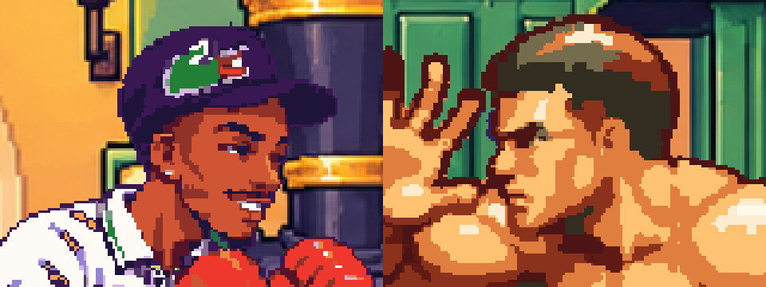
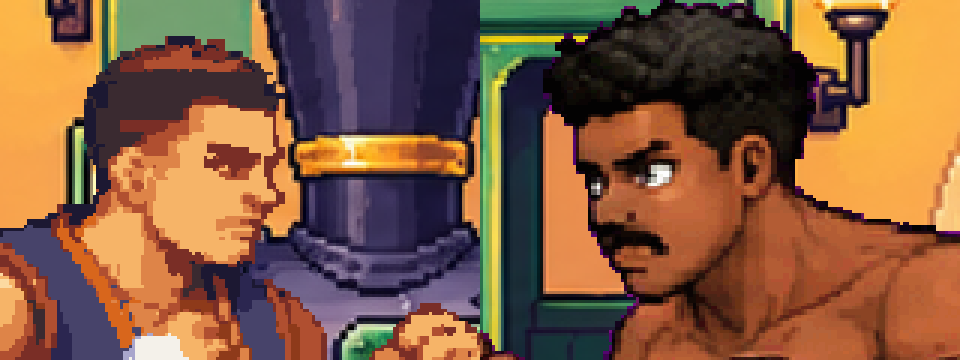

# Missão para o Alisson: Pengaró e Hazak borrados e fora do padrão

Pedido do Breno (2026-11-12): "o Pengaró ainda tá bem borrado, não dá pra ver o rosto dele, e o estilo dele tá bem
diferente dos outros". Ele pediu para conferir também o Hazak, e o Hazak tem o mesmo problema.

## O que se vê no jogo (1280x720, versão atual da `mugen`)

As imagens são recortes da tela do jogo, ampliados 3x sem suavizar.

- **CK e Gutto (o padrão):** pixel fino, contorno de 1 px, olho com brilho, rosto legível de longe.
- **Pengaró e Hazak:** pixel em blocos grandes (cerca de 3 a 4 px da janela), rosto embolado e sem olho visível. O
  estilo é outro, mais "realista anos 90", com sombra em manchas, diferente do arcade do CK e do Gutto.
- **Pengaró:** além disso, continua de pele clara. O pedido de pele bem escura, mais escuro que o Gutto e o CK, está em
  [`pengaro.md`](pengaro.md).

## De onde vem

- Os gêmeos 3x do **Pengaró** e do **Hazak** saíram do `ferramentas/hd_guiado.py`. Ele cola a figura da folha em 3x,
  mas repinta cada pixel só com as cores que o quadro de 1x tinha ali perto. O detalhe fino que não existia em 1x (o
  brilho do olho, o contorno do rosto) some, e o quadro sem par na folha fica só ampliado. O resultado é nítido na
  borda, mas embolado no rosto.
- **Gutto e Raiclaven** têm o 3x tirado da renderização 4x do Blender (`quadros_hd`). O **CK** foi convertido em 3x
  direto das folhas (`converter_ck.py` com `HD=3`). Por isso os três têm detalhe de verdade.
- A arte 1x do Pengaró e do Hazak também é de outra leva: veio antes do estilo arcade que você definiu.

## O que fazer

1. **Pengaró (forma base):** redesenhar as folhas no mesmo estilo do CK e do Gutto, com a pele bem escura.
   - Só recolorir não resolve, porque o problema é o desenho e o detalhe, não só a cor.
   - Use as folhas atuais (`sprites/pengaro/quadros/folhas*`) só como referência de pose e de golpe, para não mudar a
     jogabilidade (mesmos golpes, mesmos quadros e mesmas caixas).
2. **Hazak:** a recriação dele já está pedida (branch `hazak`, `docs/fichas/hazaki.md`). Faça no mesmo padrão: estilo do
   CK e do Gutto, convertido em 3x direto da folha.
3. **Converter em 3x direto da folha**, como o CK, seguindo a [regra da alta resolução](../regra-alta-resolucao.md).
   Não use o `hd_guiado.py` para lutador novo: ele só serve de remendo para arte que já existe em 1x.
4. **Conferir:** abrir uma luta Pengaró x CK e Hazak x Gutto e tirar a tela em 1280x720. O rosto dos quatro precisa
   ter o mesmo tamanho de pixel e o olho visível, e o robô de testes tem que continuar passando como antes.
