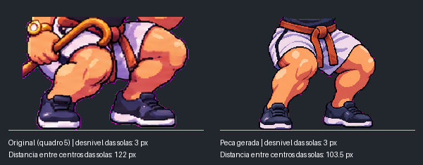
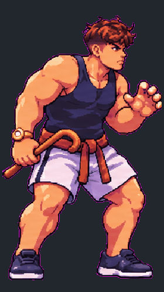

# Agachamento do Gbzin

Para a forma base, conservar a metade inferior da pose baixa original como referência do kit. Quando a mão ou o cajado passam na frente do calção, preservar o contorno visível e usar uma camada separada para o objeto. O encaixe do tronco fica na cintura.

## Comparação das imagens

No quinto quadro da folha original, a distância horizontal entre os centros das solas mede 122 px. A peça gerada mede 103,5 px quando ajustada proporcionalmente à mesma altura do recorte (161 px). A diferença é de 18,5 px, ou 15,2%. Nas duas, uma sola termina 3 px acima da outra. O apoio mais fechado altera a pose. O piloto fica como estudo.

O GIF reproduz a folha-fonte para inspeção, em cadência fixa. A medição usa a faixa inferior de cada tênis, conforme `comparar.py`. A escala de comparação é a da arte. A posição do quadril e eventuais trocas de joelho ainda precisam de inspeção visual durante qualquer integração nova.

## Testes na nuvem

A execução testa o Gbzin distribuído na revisão de base `8e354843`. A régua lê as formas base e despertada no SFF, AIR e CNS. O robô usa o IKEMEN GO 1.0.0 Linux. Os PNGs de estudo ficam fora do personagem carregado.

[Execução da régua e do robô](https://github.com/brenoalmeidatec/Jogo-de-Luta/actions/runs/45850719408)

Resultado de 26/11/2026: 236 verificações de luta passaram. A régua examinou 13 ações baixas em cada forma, com zero reprovações. Para revisão visual, marcou subida do corpo nos especiais 764, 3430 e 3435 da base e 3430, 3435 e 10764 do despertado.
