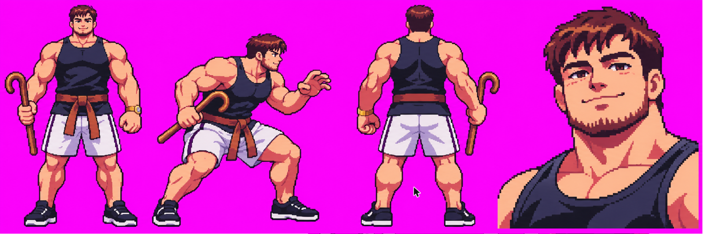

# Gbzin: recados para o Breno aprovar

Pedido do Alisson (2026-11-14): o que depende do aval do Breno fica registrado aqui e no GitHub, e o trabalho segue
sem esperar. Se algo não agradar, responda na issue ou edite este arquivo, que a arte é refeita.

## 1. Conceito da forma base (2026-11-14)

- Gerado no ChatGPT **só pela ficha**, sem as fotos (o Alisson pediu para não esperar por elas). Se quiser o rosto mais
  parecido com o rapaz das fotos, mande as fotos e o conceito é refeito em cima delas.
- Regata preta, short branco de friso preto, faixa marrom, tênis preto, relógio dourado e cajado curto de gancho na
  mão de trás, como na ficha.
- **Seguindo sem esperar:** a referência da ginga e as folhas da base saem em cima deste conceito.
