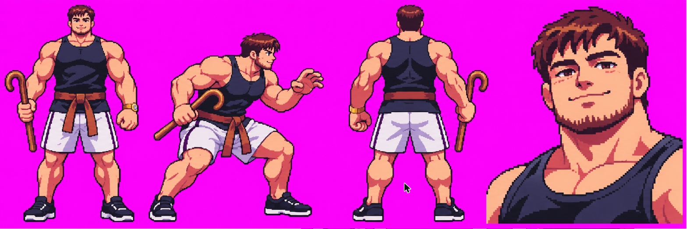
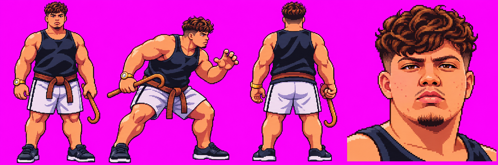
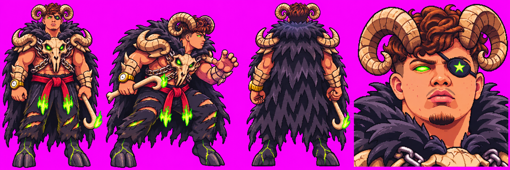

# Gbzin: recados para o Breno aprovar

Pedido do Alisson (2026-11-14): o que depende do aval do Breno fica registrado aqui e no GitHub, e o trabalho segue
sem esperar. Se algo não agradar, responda na issue ou edite este arquivo, que a arte é refeita.

## 1. Conceito da forma base (2026-11-14) — REPROVADO pelo Breno (não parecia com o rapaz)

- Gerado no ChatGPT **só pela ficha**, sem as fotos (o Alisson pediu para não esperar por elas). Se quiser o rosto mais
  parecido com o rapaz das fotos, mande as fotos e o conceito é refeito em cima delas.
- Regata preta, short branco de friso preto, faixa marrom, tênis preto, relógio dourado e cajado curto de gancho na
  mão de trás, como na ficha.
- **Seguindo sem esperar:** a referência da ginga e as folhas da base saem em cima deste conceito.

## 2. Conceito novo da forma base, pelas fotos (2026-11-15) — aguardando o Breno

- Feito no ChatGPT com as 6 fotos anexadas (branch `gbzin-fotos`; as fotos não entram na `mugen` nem nesta branch).
- Das fotos: rosto redondo, sobrancelha grossa, bigode fino, cavanhaque só no queixo, pele bronzeada, degradê nas
  laterais e corpo grande e encorpado. Roupa da ficha.
- **Para decidir:** o cabelo saiu mais cacheado que nas fotos (lá é ondulado, de franja caída). Refaço se quiser.
- A ginga e as folhas da base só são refeitas depois do aval.

## 3. Conceito do Grão-Pastor, o Despertar novo (2026-11-15) — aguardando o Breno

- Segue o pedido da issue #30: chifres em espiral, olho verde aceso, tapa-olho de estrela verde, manto de lã preta
  em farrapos, faixa vermelha com fogo verde, cajado de osso com chama na ponta e relógio maior.
- **Para decidir:** o tapa-olho fica no olho esquerdo. Como o lutador é desenhado virado para a direita, no jogo
  aparece o lado do olho aceso e o tapa-olho quase não se vê (só de frente e no retrato). Se quiser o tapa-olho
  visível na luta, ele passa para o olho direito.
- **Para decidir:** os golpes exclusivos do Deus Motoboy saíram junto com ele. A proposta de troca está na ficha
  (`docs/fichas/gbzin.md`, "Exclusivos do Grão-Pastor"): Estouro, Mão do Pastor, Berro, Puxão das Mãos e o super
  Juízo do Rebanho.
- As folhas `e_<golpe>` e os efeitos só saem depois do aval.
