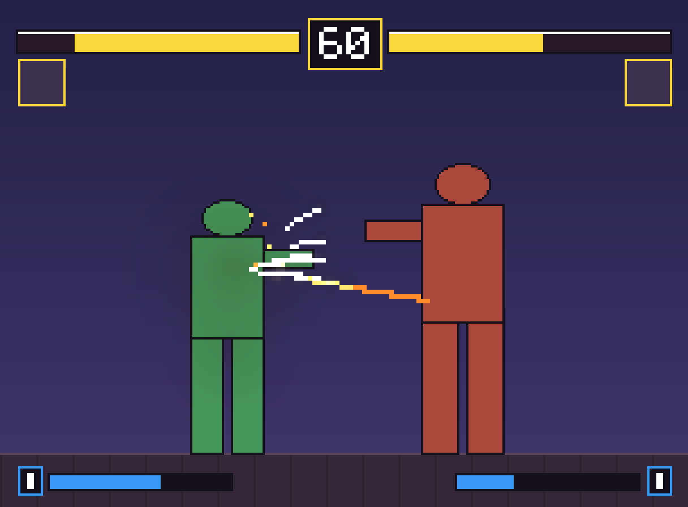

# Proporções (escala de arcade, estilo KOF)

Tudo em pixels da **tela base 304x224** (resolução dos arcades Neo Geo). No Godot:
`display/window/size/viewport_width = 304`, `viewport_height = 224`, stretch mode `viewport`,
scale mode `integer`, e texturas com Filter = Nearest. A janela pode ser 1216x896 (4x).

## Personagens
| | Altura |
|---|---|
| normal (Kaio) | 112 px (metade da tela) |
| pequeno/ágil (Yara) | 104 px |
| grande (Brutus) | 128 px |

- Chão em y = 200. Início da luta: P1 em x = 100, P2 em x = 204.
- Cenário com 608 px de largura (2 telas), câmera segue os dois lutadores.
- Efeitos do pixelfx foram feitos para um boneco de ~38 px: use **escala 2** neles.

## HUD
Valores exatos em `ferramentas/hud_layout.json`.
- **Vida**: duas barras no topo (124x9), esvaziam em direção ao centro.
- **Tempo**: caixa no meio do topo, começa em 60.
- **Retrato** 20x20 embaixo de cada barra, com o nome ao lado.
- **Barra de especial** embaixo (80x6) com o contador de estoque (até 3) no canto.
