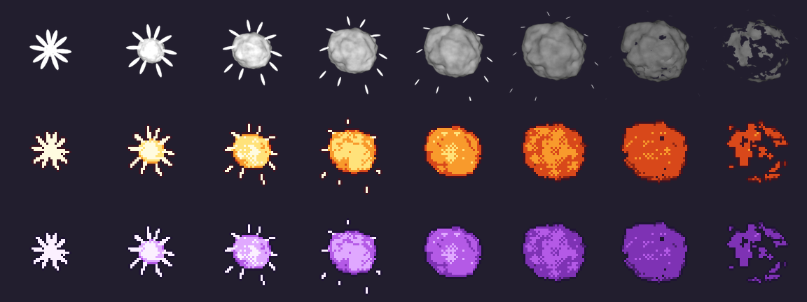

# Efeitos no Blender em pixel art (pixel FX)

**Pixel FX aqui é a técnica**: o efeito nasce em 3D no Blender (bola de fogo, faísca, fumaça, poeira) e é reduzido
para sprite de pixel art com poucas cores, sem anti-aliasing, alfa só 0 ou 255, contorno seco de 1 px e um pouco de
dithering ordenado onde um tom vira outro. Não confunda com a biblioteca [pixelfx](https://github.com/patch-gg/pixelfx)
antiga de `assets/efeitos/`, que sai conforme os efeitos novos entram ([regra dos efeitos](../../docs/regra-efeitos-proporcionais.md)).
Isto é só para **efeito**: lutador continua desenhado, nunca 3D pixelizado.



## Preparar a máquina (nuvem ou Linux zerado)

```bash
bash ferramentas/efeitos_pixel/preparar_nuvem.sh            # bpy 5.3 + Pillow + numpy (~6 s numa máquina zerada)
bash ferramentas/efeitos_pixel/preparar_nuvem.sh --binario  # + Blender 4.5 LTS portátil, conferido pelo sha256 (~35 s)
bash ferramentas/efeitos_pixel/preparar_nuvem.sh --testar   # + renderiza o exemplo no fim
source ~/.nazafight/ambiente.sh                             # NAZAFX_PY (Python com bpy) e BLENDER (se --binario)
```

O script pode rodar no começo de toda tarefa: o que já está pronto ele pula (a segunda vez leva menos de 1 s). Ele usa o
`uv` quando existe (e baixa o Python 3.13 se faltar), senão `python3.13 -m venv` + `pip`. Fica tudo em `~/.nazafight`
(mude com `NAZAFX_HOME`), fora do repositório.

O `--binario` serve para as ferramentas que chamam `blender -b --python` (`animar_folha.py`, `aura_blender/`): com o
`ambiente.sh` carregado, a variável `BLENDER` já aponta para ele.

## Exemplo: explosão com faíscas

```bash
"$NAZAFX_PY" ferramentas/efeitos_pixel/exemplo_explosao.py
"$NAZAFX_PY" ferramentas/efeitos_pixel/exemplo_explosao.py --paletas fogo violeta eletrico --tam 64
```

Monta a cena por código, renderiza 8 quadros em Cycles na CPU (em cinza e 4x maior que a arte, em menos de 1 s) e passa
cada paleta pelo `pixelfx.py`. Sai em `ferramentas/efeitos_pixel/saida/` (fora do git):

| Arquivo | O que é |
|---|---|
| `render/0000.png..` | render bruto do Blender, RGBA |
| `explosao_<paleta>/00.png..07.png` | os sprites, 144x144 (arte de 48 px em 3x), fundo transparente |
| `explosao_<paleta>/folha.png` | os 8 quadros em fila, fundo transparente |
| `explosao_<paleta>/previa.png` e `.gif` | para olhar, em fundo escuro |
| `comparacao.png` | render em cima, uma linha por paleta |

Os sprites saem no padrão 3x ([regra-alta-resolucao.md](../../docs/regra-alta-resolucao.md)): no `Explod` use
`scale = 1/3`, porque Explod não usa a escala do lutador.

## Reduzir qualquer render

```bash
python ferramentas/efeitos_pixel/pixelfx.py PASTA_DO_RENDER/ SAIDA/ --paleta fogo --tam 48 --bloco 3
python ferramentas/efeitos_pixel/pixelfx.py PASTA_DO_RENDER/ SAIDA/ --paleta "#3c1422,#8a2414,#d8481a,#ffe27a"
```

- `--modo rampa` (padrão): o brilho escolhe a cor numa rampa escura para clara. Renderize em branco/cinza e troque só
  a paleta para dar a cor de cada lutador. `--modo cores` vai para a cor mais próxima, para render que já tem cor.
- A primeira cor da paleta é o contorno (nunca preto puro, regra 5 do arcade). Paletas prontas: `fogo`, `violeta`,
  `eletrico`, `faisca`, `poeira`.
- `--dither 0` tira o dithering de cor; `--dither-alfa` controla a borda quadriculada de quando o efeito some;
  `--gama` acima de 1 escurece os tons do meio; `--sem-contorno` tira o contorno.

## Próximos passos sugeridos

- Fazer os seis efeitos da [regra dos efeitos](../../docs/regra-efeitos-proporcionais.md) (ventinho, estalo, impacto,
  poeira de queda, faísca de defesa, faísca de parry) como cenas irmãs do `exemplo_explosao.py`, cada um no tamanho do golpe.
- Uma paleta de efeito por lutador (tirada da `paleta_arcade.json` dele) e ligar no gerador com `Explod` em `scale = 1/3`.
- Filmar um soco fraco, um forte e um super com os efeitos novos, como pede a conferência.
